# LightAPI class diagrams

This page is the class-level map of the `lightapi/` package: one snapshot taken before the object-oriented refactor and one that will be added when it ends. Every diagram is a Mermaid block; mkdocs renders them through the `mermaid` custom fence of `pymdownx.superfences` (`mkdocs.yml:121-125`).

## Before the refactor

Snapshot of commit `d24c7f3` on branch `refactor/oo-second-pass`, the tree at the moment the refactor started: 35 Python files (`git ls-files lightapi` = 35), 4647 lines in total. Every file and line cited below was read from that tree; check a citation with `git show d24c7f3:lightapi/<file>`, not against a later working tree. While this page was being written the working tree had already started to move (`rest.py`, `constants.py`, `lightapi.py`, `endpoint_handler.py`, `cache_helper.py`, `_login.py`, `rate_limiter.py`, `core.py`, `authentication/basic.py` changed on disk), so some of the facts in the Diagnosis check, in particular claims 5 and 10, are already being fixed.

### Module overview

Solid arrows are top-level imports, dashed arrows are imports made inside a function body. Imports that only exist under `if TYPE_CHECKING:` are not drawn; they are listed after the diagram. Modules with no intra-package imports (`constants`, `exceptions`, `core`, `methods`, `fields`, `filters`, `health`, `middleware_runner`, `session`, `session_manager`, `repository`, `rate_limiter`) appear only as targets.

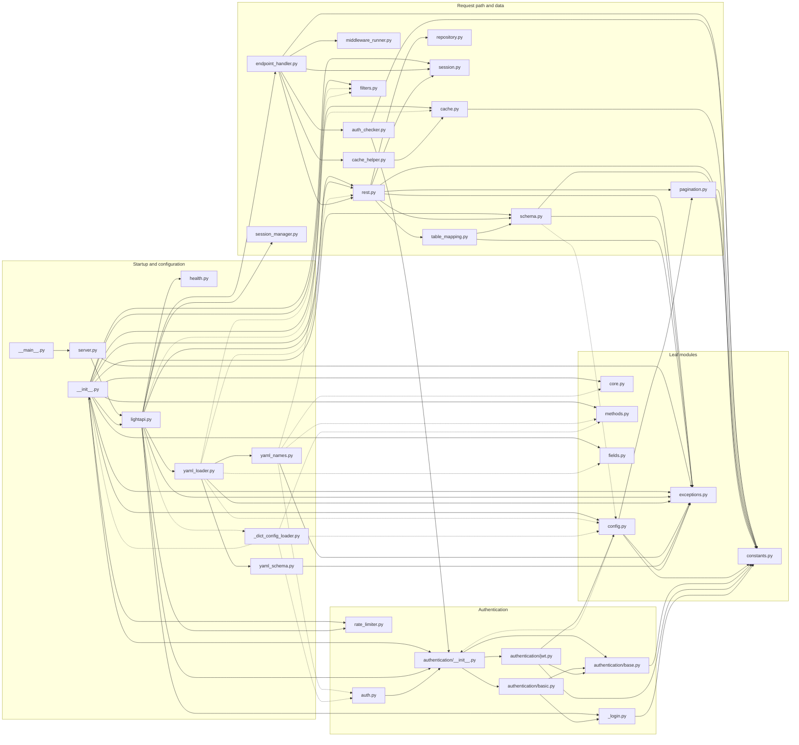

`TYPE_CHECKING`-only imports (type hints, never executed): `table_mapping.py:17` -> `session_manager`; `config.py:19-20` -> `authentication`, `rate_limiter`; `endpoint_handler.py:23` -> `authentication.base`; `_login.py:18-19` -> `authentication.base`, `rate_limiter`; `auth_checker.py:14-15` -> `authentication.base`, `config`; `authentication/base.py:13` -> `config`; `authentication/basic.py:14-15` -> `config`, `rate_limiter`; `authentication/jwt.py:17-18` -> `config`, `rate_limiter`.

The second diagram shows the three pieces of process-wide state and every external dependency, with the module that touches each one.

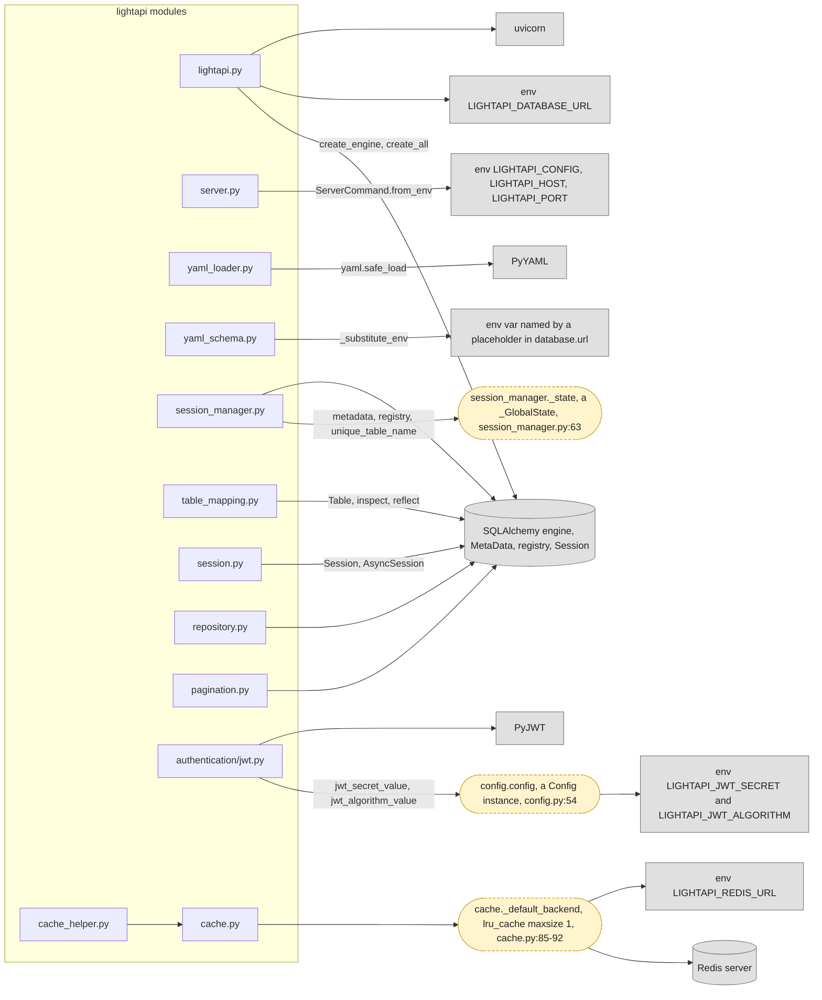

Where each piece of global state is read or written:

- `config.config` (`config.py:54`): read by `JWTAuthentication.authenticate` (`authentication/jwt.py:74, 81`) and `JWTAuthentication.generate_token` (`jwt.py:117, 127`). Its properties read `LIGHTAPI_JWT_SECRET` (`config.py:38`) and `LIGHTAPI_JWT_ALGORITHM` (`config.py:42-44`) on every call.
- `session_manager._state` (`session_manager.py:63`): read by `SessionManager.__init__` (`session_manager.py:85-90`) and `SessionManager.table_name_for` (`session_manager.py:114`). It holds the one `MetaData` and `registry` shared by every non-isolated app, plus a thread-local pair and table-name counters for `use_test_isolation=True`.
- `cache._default_backend` (`cache.py:85-92`): an `lru_cache(maxsize=1)` function that builds one `RedisCacheBackend` on first call; read by `_ping_redis`, `get_cached`, `set_cached`, `invalidate_cache_prefix` (`cache.py:97, 102, 107, 112`). `RedisCacheBackend.__init__` reads `LIGHTAPI_REDIS_URL` (`cache.py:20-22`).

Other environment reads: `LIGHTAPI_DATABASE_URL` in `lightapi._engine_from_url` (`lightapi.py:324`); `LIGHTAPI_CONFIG`, `LIGHTAPI_HOST`, `LIGHTAPI_PORT` in `ServerCommand.from_env` (`server.py:37, 43, 44`); any `${VAR}` placeholder in `database.url` in `yaml_schema._substitute_env` (`yaml_schema.py:25-35`).

Small modules not drawn in detail below: `exceptions.py` (`ConfigurationError`, `SerializationError`), `methods.py` (`HttpMethod` namespace with inner marker classes `GET`, `POST`, `PUT`, `PATCH`, `DELETE`, each carrying `_http_method`), `fields.py` (`Field(**kwargs) -> FieldInfo`, strips the five LightAPI column kwargs into `json_schema_extra`), `core.py` (legacy `Response`, `Middleware`, `CORSMiddleware`, `AuthenticationMiddleware`; nothing in the package imports it except the YAML name registry), `auth.py` (re-export of `lightapi.authentication`), `__main__.py` (calls `server.main`).

### Core

Modules: `lightapi.py`, `rest.py`, `schema.py`, `table_mapping.py`, `repository.py`.

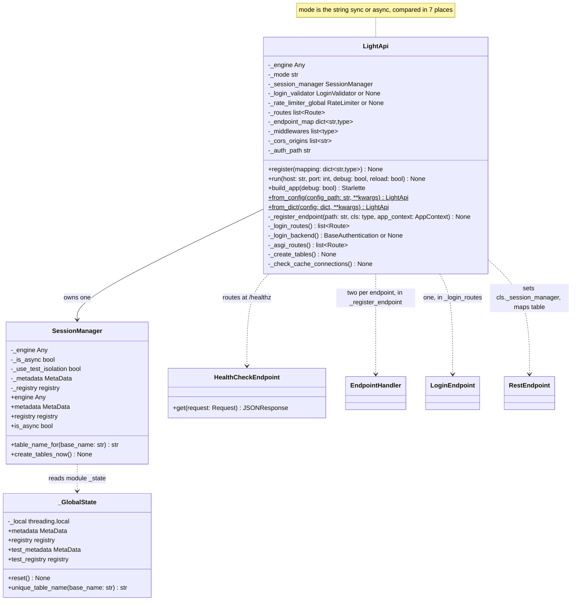

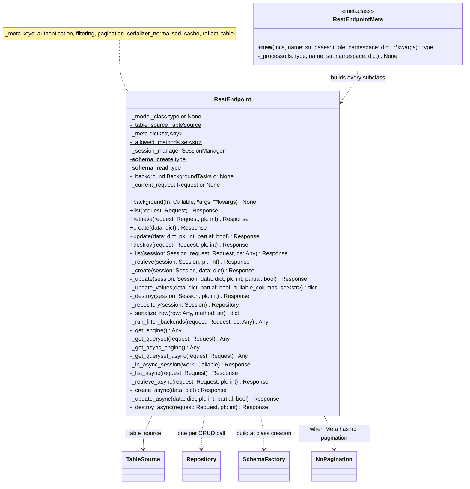

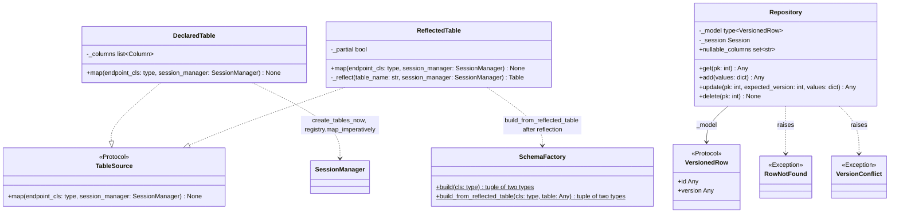

Module-level functions in the Core modules:

`lightapi.py` (constants `_LOGIN_RATE_LIMITS` lines 35-39, `_ASYNC_HANDLER_NAMES` line 320):

- `_engine_from_url(database_url: str | None) -> Any` (323): reads `LIGHTAPI_DATABASE_URL`; called by `LightApi.__init__` (69).
- `_checked_mode(mode: str | None) -> str` (333): compares against the literals `"sync"`/`"async"`; called by `__init__` (70).
- `_as_rate_limiter(value: RateLimiter | dict[str, int] | None) -> RateLimiter | None` (342): reads `_LOGIN_RATE_LIMITS`; called by `__init__` (75).
- `_require_rest_endpoint(path: str, cls: Any) -> None` (353): called by `register` (95).
- `_has_async_handlers(cls: type) -> bool` (361): reads the attributes named in `_ASYNC_HANDLER_NAMES` on the endpoint class; called by `register` (98).
- `_require_async_engine(engine: Any) -> None` (369): called by `register` (101).
- `_validate_async_dependencies(engine: Any) -> None` (383): reads `engine.url.get_dialect().name`; called by `run` (176).

`rest.py` (constants `_AUTO_FIELDS` 48, `_TYPE_MAP` 50-58, `_ALL_METHODS` 60, `_VERSION_ADAPTER` 66, `_ERROR_RESPONSES` 251-254):

- `_is_optional(annotation: Any) -> tuple[bool, Any]` (69): called by `_column_for` (181).
- `_reject_redeclared_auto_fields(name: str, namespace: dict) -> None` (132): reads `namespace["__annotations__"]`; called by `RestEndpointMeta._process` (111).
- `_field_annotations(cls: type) -> dict[str, Any]` (141): walks `cls.__mro__`; called by `_declared_columns` (164).
- `_declared_columns(cls: type, name: str, namespace: dict) -> list[Column]` (160): called by `_process` (127).
- `_column_for(endpoint_name: str, field_name: str, annotation: Any, field_info: Any) -> Column | None` (173): reads `_TYPE_MAP` and the `FieldInfo.json_schema_extra` written by `fields.Field`; called by `_declared_columns` (167).
- `_auto_columns() -> list[Column]` (201): called by `_process` (129).
- `_parsed_meta(name: str, meta_obj: Any) -> dict[str, Any]` (216): builds the `cls._meta` dict with its seven keys (230-238), calls `normalise_serializer`; called by `_process` (117).
- `_allowed_methods(cls: type) -> set[str]` (241): reads `_http_method` on every MRO base; called by `_process` (118).
- `_error_response(error: Exception) -> Response` (257): reads `_ERROR_RESPONSES`; called by `_retrieve` (364), `_update` (401), `_destroy` (425).
- `_unprocessable(errors: Any) -> Response` (262): called by `_create` (371), `_update` (384, 390, 396).

`schema.py` (constants `_AUTO_FIELDS` 18, `_REFLECTED_PYTHON_TYPES` 108-120, `_AUTO_READ_FIELDS` 148-153):

- `normalise_serializer(serializer: object) -> tuple[list[str] | None, list[str] | None, list[str] | None]` (21) (imported by tests, `tests/test_serializer.py:12`): imports `config.Serializer` inside the function (29); called by `rest._parsed_meta` (234).
- `resolve_fields(cls: type, method: str) -> list[str] | None` (51) (imported by tests, `tests/test_pipeline.py:6`): reads `cls._meta.get("serializer_normalised")` (53); called by `RestEndpoint._serialize_row` (340).
- `_row_to_dict(row: Any) -> dict[str, Any]` (61) (imported by tests, `tests/test_pipeline.py:6`): called by `_serialize_row` (339).
- `_apply_fields(d: dict, fields: list[str] | None) -> dict` (82) (imported by tests, `tests/test_pipeline.py:6`): called by `_serialize_row` (341).
- `patch_schema(schema_create: type[BaseModel]) -> type[BaseModel]` (90, `@lru_cache(maxsize=None)` at 89) (imported by tests, `tests/test_repository.py:10`): called by `RestEndpoint._update_values` (413).
- `_reflected_annotation(column: Any) -> Any` (123): called by `SchemaFactory.build_from_reflected_table` (240).
- `_schema_pair(endpoint_name: str, create_fields: dict, read_fields: dict) -> tuple[type, type]` (156): reads `_AUTO_READ_FIELDS`; called by `SchemaFactory.build` (226) and `build_from_reflected_table` (246).

`table_mapping.py`:

- `_table_name(endpoint_cls: type, session_manager: SessionManager) -> str` (86): reads `endpoint_cls._meta.get("table")` (87) and `session_manager.table_name_for`; called by `DeclaredTable.map` (38) and `ReflectedTable.map` (63).
- `_strip_field_infos(endpoint_cls: type, columns: list[Column]) -> None` (91): deletes `FieldInfo` and `...` class attributes; called by `DeclaredTable.map` (36) and `ReflectedTable.map` when partial (66).
- `_reflect_sync(engine: Any, metadata: MetaData, table_name: str) -> Table` (102): called by `ReflectedTable._reflect` (81).
- `_reflect_async(engine: Any, metadata: MetaData, table_name: str) -> Table` (110): runs `asyncio.run` or a one-thread pool; called by `ReflectedTable._reflect` (78).

`repository.py` (constants `FIRST_VERSION` 11, `_MIN_PK`/`_MAX_PK` 16-17):

- `_in_pk_range(pk: int) -> bool` (20): called by `Repository.get` (61), `update` (83), `delete` (101).
- `_utcnow() -> datetime.datetime` (111): called by `Repository.add` (72) and `update` (89).

### Request path

Modules: `endpoint_handler.py`, `auth_checker.py`, `cache_helper.py`, `middleware_runner.py`, `session.py`.

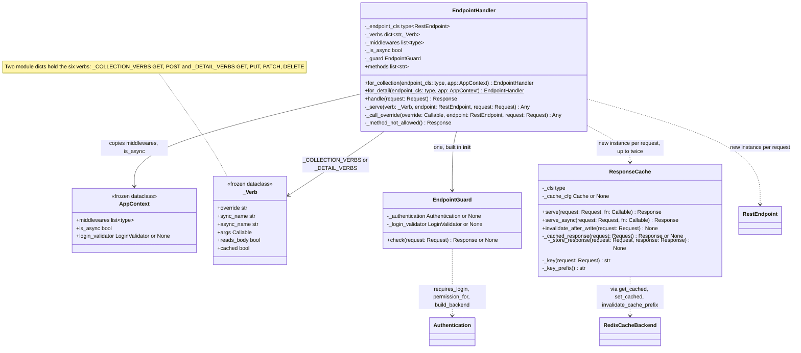

Module-level functions:

- `endpoint_handler.py`: five argument adapters with the same signature `(request: Request, data: dict, pk: Any) -> tuple[Any, ...]`: `_request_only` (47), `_data_only` (51), `_request_and_pk` (55), `_full_update` (59, returns `(data, pk, False)`), `_partial_update` (63, returns `(data, pk, True)`). They are the `args` field of the `_Verb` entries in `_COLLECTION_VERBS` (67-70) and `_DETAIL_VERBS` (72-79), called from `EndpointHandler._serve` (147). `async _read_body(request: Request) -> dict[str, Any]` (191): `except Exception` returns `{}`; called by `_serve` (146).
- `middleware_runner.py`: `async run_pre_middlewares(middlewares: list[type], request: Request) -> Response | None` (9) and `async run_post_middlewares(middlewares: list[type], request: Request, response: Response) -> Response` (24). Both instantiate every middleware class (`mw_cls()`, lines 14 and 29) on every request and accept a sync or async `process`; called from `EndpointHandler.handle` (121, 141).
- `session.py` (constant `_SINGLE_CONNECTION_POOLS` 21): `get_sync_session(engine: Engine)` context manager (24-33, commit on exit, rollback and re-raise on exception), `get_async_session(engine: AsyncEngine)` async context manager (36-47, imports `AsyncSession` inside the function), `async run_blocking(engine: Engine, fn: Callable, *args) -> T` (50): runs `fn` in place when the engine pool is `SingletonThreadPool` or `StaticPool`, otherwise in Starlette's thread pool; called from `EndpointHandler._serve` (166, 167) and `_call_override` (180). `get_sync_session` and `get_async_session` are exported from `lightapi/__init__.py:30` and used by `RestEndpoint.list/retrieve/create/update/destroy` (435-455) and `_in_async_session` (489).

One request, from the Starlette route to the database. The left column says what already exists when the request arrives (built once in `LightApi.register`) and what is created on this request.

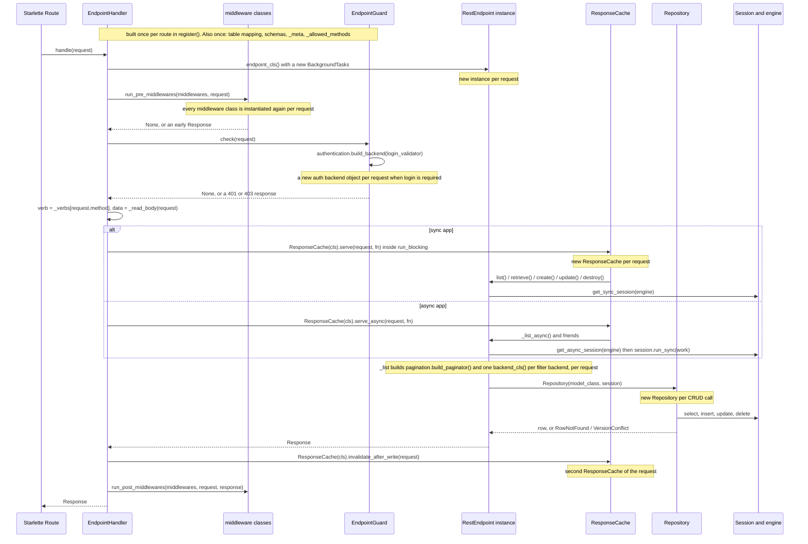

Created once, in `LightApi.register` -> `_register_endpoint` (`lightapi.py:109-133`): the table mapping (`cls._table_source.map`, 111), two `EndpointHandler`s (115-116) each with its `EndpointGuard` (`endpoint_handler.py:95-97`), and two Starlette `Route`s (117-132). Earlier still, at class-definition time in `RestEndpointMeta._process` (`rest.py:110-129`): `cls._meta`, `cls._allowed_methods`, the create and read schemas (declared tables) and the `TableSource`.

Created per request: the `RestEndpoint` instance and its `BackgroundTasks` (`endpoint_handler.py:117-118`), one instance of each middleware class twice (pre and post, `middleware_runner.py:14, 29`), the authentication backend (`auth_checker.py:36` via `config.py:95`), up to two `ResponseCache` objects (`endpoint_handler.py:136, 157, 165`), the paginator (`rest.py:355`), one instance of each filter backend class (`rest.py:334`), the `Repository` per CRUD call (`rest.py:429`), and the `Session` (`rest.py:435-455, 489`).

### Authentication

Modules: `config.py` (`Authentication`, `Config`), `authentication/base.py`, `authentication/basic.py`, `authentication/jwt.py`, `_login.py`, `auth.py`, `rate_limiter.py`.

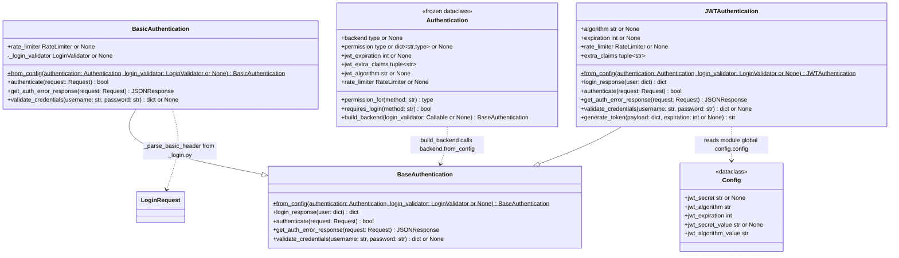

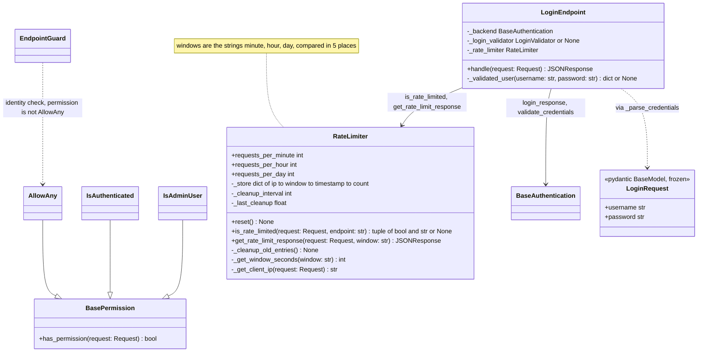

How a backend is built: `Authentication.build_backend(login_validator)` (`config.py:92-95`) calls `self.backend.from_config(self, login_validator)`. `BaseAuthentication.from_config` (`base.py:25-35`) returns `cls()`; `BasicAuthentication.from_config` (`basic.py:33-44`) and `JWTAuthentication.from_config` (`jwt.py:40-54`) pass the `Authentication` settings to their constructors, unless the subclass overrides `__init__`, in which case `cls()` is used. `build_backend` has two callers: `EndpointGuard.check` (`auth_checker.py:36`, once per request that requires login) and `LightApi._login_backend` (`lightapi.py:160`, once per app, for the login routes).

`LoginEndpoint` (`_login.py:79-140`) answers `POST {auth_path}/login` and `POST {auth_path}/token` (`lightapi.py:144-147`). Order inside `handle`: rate limit (98-102), method check (104-109), credentials from a Basic header or a `LoginRequest` body (112-117, 422 on a pydantic error), `_validated_user` (119, which prefers the app's `login_validator` over the backend's `validate_credentials` and awaits an awaitable result), then `backend.login_response(user)` (125).

Module-level functions of `_login.py`: `_parse_basic_header(auth_header: str) -> tuple[str, str] | None` (33, called by `BasicAuthentication.authenticate` at `basic.py:54` and by `_parse_credentials` at 63), `async _parse_credentials(request: Request) -> tuple[str, str] | None` (52, called by `LoginEndpoint.handle` 112), `async _read_body(request: Request) -> dict[str, Any]` (70, a second copy of `endpoint_handler._read_body` with a narrower `except`, called by `_parse_credentials` 65).

Import cycle: `authentication/jwt.py:13` imports `config` at module level (`from lightapi.config import config`), and `authentication/__init__.py:14` imports `jwt`. `config.py` needs `AllowAny` from `lightapi.authentication` for `permission_for` and `requires_login`, so it imports it inside both methods (`config.py:72` and `config.py:84`) instead of at the top; the comment at `config.py:71` names the cycle. The type-only imports at `config.py:19-20` sit under `TYPE_CHECKING` for the same reason.

### Cache

Modules: `cache.py`, `cache_helper.py`, `config.py` (`Cache`).

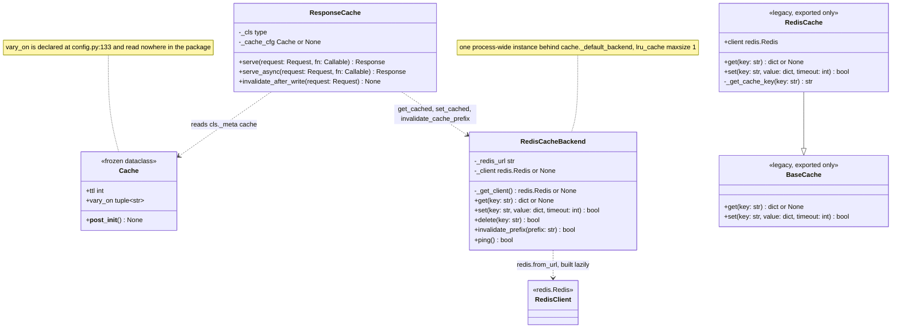

Module-level functions of `cache.py`: `_default_backend() -> RedisCacheBackend` (85-92, `@lru_cache(maxsize=1)`, the global), `_ping_redis() -> bool` (95, called by `LightApi._check_cache_connections` through an in-function import at `lightapi.py:308-310`), `get_cached(key: str) -> Any | None` (100), `set_cached(key: str, value: Any, ttl: int) -> None` (105), `invalidate_cache_prefix(prefix: str) -> None` (110). The last three are called by `ResponseCache` (`cache_helper.py:61, 73, 52`); `invalidate_cache_prefix` is also documented for user code in `docs/advanced/caching.md:111`.

`ResponseCache` (`cache_helper.py:13-82`) is a no-op when `cls._meta.get("cache")` is `None` (26, 39, 50). The key is `lightapi:{ClassName}:{path}:{query}` (77-79); invalidation deletes `lightapi:{ClassName}:*` after any non-GET request (48-52). Only `JSONResponse` with status 200 is stored (67). Redis errors are swallowed in both the backend (`cache.py:29, 40, 50, 60, 72, 81`) and the helper (`cache_helper.py:62, 74`).

`BaseCache` and `RedisCache` (`cache.py:115-215`) are exported from `lightapi/__init__.py:12, 65` and have no caller inside the package.

### Pagination and filters

Modules: `pagination.py`, `filters.py`, `config.py` (`Pagination`, `Filtering`).

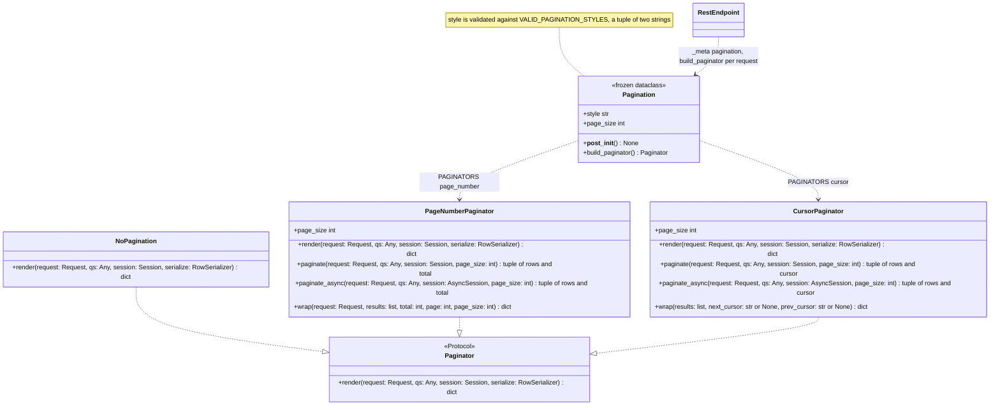

Module-level names of `pagination.py`: `encode_cursor(last_id: int) -> str` (18) and `decode_cursor(cursor: str) -> int` (22), both `base64(json({"id": last_id}))`, called only by `CursorPaginator.paginate` (146, 166); `_current_page(request: Request) -> int` (26), reads `?page=` and falls back to 1 on a non-numeric value, called twice per page-number request, by `PageNumberPaginator.render` (66) and `paginate` (77); `RowSerializer` alias (35); `PAGINATORS: dict[str, type]` (194-197) mapping `"page_number"` and `"cursor"` to the two classes, read by `Pagination.build_paginator` (`config.py:125`). `paginate_async` on both paginators is not called anywhere in the package; `render` always receives a sync `Session` because the async path goes through `AsyncSession.run_sync` (`rest.py:490`).

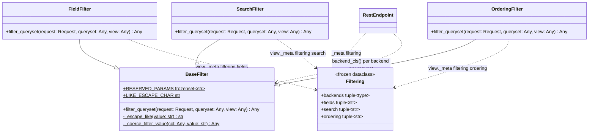

Module-level function of `filters.py`: `_coerce_filter_value(col: Any, value: str) -> Any` (55-62), an alias of `BaseFilter._coerce_filter_value` (33-52). It is documented as importable for custom backends in `docs/api-reference/filters.md:125-133` and recorded in the public-API snapshot `tests/data/public_api.json:198`, so it is public despite the underscore. The three filter backends read `view._meta.get("filtering")` (`filters.py:69, 95, 125`) and `type(view)._model_class` (80, 105, 139); `RestEndpoint._run_filter_backends` (`rest.py:329-335`) instantiates each backend class on every request (334).

### Configuration

Modules: `config.py`, `yaml_schema.py`, `yaml_loader.py`, `yaml_names.py`, `_dict_config_loader.py`, `server.py`, `health.py`, `constants.py`.

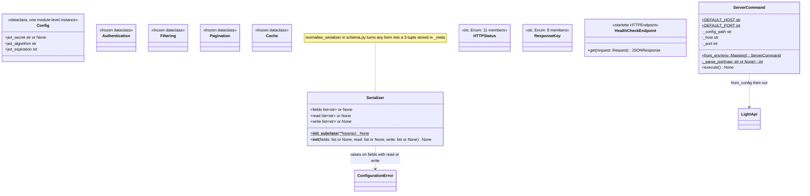

`constants.py`: `HTTPStatus(int, Enum)` (7-18) with `OK`, `CREATED`, `NO_CONTENT`, `BAD_REQUEST`, `UNAUTHORIZED`, `FORBIDDEN`, `NOT_FOUND`, `METHOD_NOT_ALLOWED`, `CONFLICT`, `UNPROCESSABLE_ENTITY`, `TOO_MANY_REQUESTS`; `ResponseKey(str, Enum)` (24-32) with `DETAIL`, `RESULTS`, `TOKEN`, `USER`, `COUNT`, `PAGES`, `NEXT`, `PREVIOUS`; plain constants `DEFAULT_PAGE_SIZE` (38), `PAGE_PARAM` (39), `CURSOR_PARAM` (40), `VALID_PAGINATION_STYLES` (41), `AUTO_FIELDS` (46), `DEFAULT_JWT_ALGORITHM` (51), `DEFAULT_JWT_EXPIRATION` (52), `VALID_JWT_ALGORITHMS` (53-65), `DEFAULT_REDIS_URL` (70), `DEFAULT_CACHE_TTL` (71).

`server.py`: `ServerCommand` (19-59) reads `LIGHTAPI_CONFIG`, `LIGHTAPI_HOST`, `LIGHTAPI_PORT` in `from_env` (36-45) and calls `LightApi.from_config(path).run(host, port)` in `execute` (58-59). `main(argv: list[str] | None = None) -> None` (62-68) accepts only the `serve` command; it is the `lightapi` console script (`pyproject.toml:81`) and the target of `__main__.py:3`.

`health.py`: `HEALTH_PATH = "/healthz"` (9) and `HealthCheckEndpoint.get` returning `{"status": "ok"}` (20-21), routed last by `LightApi._asgi_routes` (`lightapi.py:211`).

The YAML side is a set of pydantic models plus loose builder functions that turn them into `RestEndpoint` subclasses. First the root document and one endpoint entry:

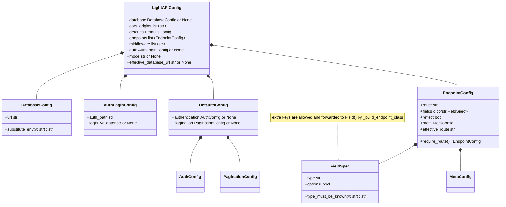

Then the `meta:` block of an endpoint, which mirrors the `config.py` dataclasses one to one:

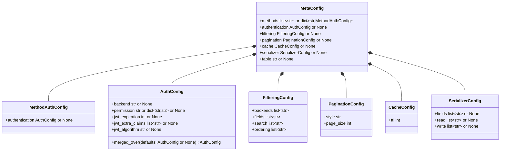

`yaml_schema.py` also holds `YAML_FIELD_TYPES` (14-22, seven type names) and the loose function `_substitute_env(value: str) -> str` (25-35), called only by the `DatabaseConfig.substitute_env` validator (46). The model `mode` (182) and `PaginationConfig.style` (89) are plain `str` fields; they are validated later, by `lightapi._checked_mode` and `config.Pagination.__post_init__`.

`yaml_loader.py`, eleven functions, in call order from the entry point:

- `load_config(app_cls: type, config_path: str, **overrides) -> Any` (304): `yaml.safe_load`, `LightAPIConfig.model_validate`, resolves middleware names, builds the `LightApi` and registers the endpoints; called by `LightApi.from_config` (`lightapi.py:229`).
- `_build_endpoint_class(entry: EndpointConfig, defaults: DefaultsConfig) -> type` (231): class name from the route (238-240), `Field(**kwargs)` per `FieldSpec` (245-286), then `type(class_name, bases, class_attrs)` (296); called by `load_config` (352).
- `_build_meta_class(meta: MetaConfig, defaults: DefaultsConfig, reflect: bool) -> type` (152): builds the inner `Meta` class; called by `_build_endpoint_class` (289).
- `_resolve_methods_bases(meta: MetaConfig) -> tuple[type, ...]` (206): `RestEndpoint` plus one `HttpMethod` mixin per listed verb via `name_registry()`; called by `_build_endpoint_class` (293).
- `_make_authentication(auth_cfg: AuthConfig | None, defaults_auth: AuthConfig | None) -> Any` (46): list form of `methods`; called by `_build_meta_class` (169).
- `_per_method_authentication(meta: MetaConfig, defaults: DefaultsConfig) -> Any` (57): dict form of `methods`; called by `_build_meta_class` (167).
- `_permission_name(method: str, method_auth: AuthConfig | None, default_permission: str | dict | None) -> str | None` (80): called by `_per_method_authentication` (70).
- `_resolved_permission(permission: str | dict[str, str] | None) -> Any` (93): `resolve_name` on one name or on each value of a per-method dict; called by `_make_authentication` (54).
- `_authentication_from(settings: AuthConfig, permission: Any) -> Any` (102): builds `config.Authentication`; called by `_make_authentication` (54) and `_per_method_authentication` (77).
- `_make_filtering(filtering_cfg: FilteringConfig | None) -> Any` (114): auto-selects `FieldFilter`/`SearchFilter`/`OrderingFilter` when no backends are named (127-133); called by `_build_meta_class` (173).
- `_make_pagination(pag_cfg: PaginationConfig | None) -> Any` (143): called by `_build_meta_class` (179).

`yaml_names.py`, three functions: `name_registry() -> dict[str, type]` (11-45) builds the short-name table (five auth classes, three filters, three middlewares, five `HttpMethod` mixins) on every call, importing them inside the function; `resolve_callable(dotted_path: str) -> Any` (48-97) imports a dotted path and checks it is a sync callable with exactly two required positional parameters, used for `auth.login_validator` (`yaml_loader.py:341`); `resolve_name(name: str) -> Any` (100-120) looks up the registry then falls back to a dotted import, used for backends, permissions, filters and middleware (`yaml_loader.py:72, 96, 98, 106, 123, 326`).

`_dict_config_loader.py`, two functions: `load_from_dict(app_cls: type, config: dict[str, Any], **overrides) -> Any` (11-147), the body of the deprecated `LightApi.from_dict` (`lightapi.py:255-264`), which builds endpoint classes from `{"fields": {...}, "auth": "jwt" | "basic", "paginate": ..., "filters": ..., "methods": [...]}` entries with its own copy of the method-name map (125-131); `_route_to_class_name(route: str) -> str` (150-153).

### Owner of each module-level function

| Function | Module | Data it uses | Proposed owner |
|---|---|---|---|
| `_engine_from_url` | lightapi.py:323 | `database_url`, env `LIGHTAPI_DATABASE_URL` | `LightApi` |
| `_checked_mode` | lightapi.py:333 | the mode string, literals `"sync"`/`"async"` | enum `ExecutionMode` |
| `_as_rate_limiter` | lightapi.py:342 | a `RateLimiter` or limits dict, `_LOGIN_RATE_LIMITS` | `RateLimiter.from_limits` |
| `_require_rest_endpoint` | lightapi.py:353 | path and class from the `register` mapping | `LightApi` |
| `_has_async_handlers` | lightapi.py:361 | endpoint attributes named in `_ASYNC_HANDLER_NAMES` | `LightApi` |
| `_require_async_engine` | lightapi.py:369 | the engine type | `LightApi` |
| `_validate_async_dependencies` | lightapi.py:383 | `engine.url` dialect, installed drivers | `LightApi` |
| `_is_optional` | rest.py:69 | one field annotation | `DeclaredTable` |
| `_field_annotations` | rest.py:141 | `cls.__mro__`, `__annotations__`, `AUTO_FIELDS` | `DeclaredTable` |
| `_declared_columns` | rest.py:160 | class namespace, `FieldInfo` values | `DeclaredTable` |
| `_column_for` | rest.py:173 | annotation, `FieldInfo.json_schema_extra`, `_TYPE_MAP` | `DeclaredTable` |
| `_auto_columns` | rest.py:201 | nothing (fixed four columns) | `DeclaredTable` |
| `_reject_redeclared_auto_fields` | rest.py:132 | `namespace["__annotations__"]`, `AUTO_FIELDS` | `RestEndpointMeta` |
| `_parsed_meta` | rest.py:216 | the `Meta` inner class attributes | `RestEndpointMeta` |
| `_allowed_methods` | rest.py:241 | `_http_method` on MRO bases, `_ALL_METHODS` | `RestEndpointMeta` |
| `_error_response` | rest.py:257 | `_ERROR_RESPONSES`, the exception type | enum `ApiError` |
| `_unprocessable` | rest.py:262 | pydantic error list | enum `ApiError` |
| `normalise_serializer` | schema.py:21 | a `Serializer` instance or subclass | `FieldProjection` (NamedTuple) |
| `resolve_fields` | schema.py:51 | `cls._meta["serializer_normalised"]`, the HTTP method | `FieldProjection` (NamedTuple) |
| `_apply_fields` | schema.py:82 | a row dict and the field list | `FieldProjection` (NamedTuple) |
| `_row_to_dict` | schema.py:61 | ORM instance, `Row`, dict or object | `SchemaFactory` |
| `patch_schema` | schema.py:90 | the create schema's `model_fields` | `SchemaFactory` |
| `_schema_pair` | schema.py:156 | endpoint name, field dicts, `_AUTO_READ_FIELDS` | `SchemaFactory` |
| `_reflected_annotation` | schema.py:123 | a SQLAlchemy `Column.type`, `_REFLECTED_PYTHON_TYPES` | `SchemaFactory` |
| `_table_name` | table_mapping.py:86 | `endpoint_cls._meta["table"]`, class name, `SessionManager.table_name_for` | `DeclaredTable` / `ReflectedTable` (shared) |
| `_strip_field_infos` | table_mapping.py:91 | class `__dict__`, column names | `DeclaredTable` / `ReflectedTable` (shared) |
| `_reflect_sync` | table_mapping.py:102 | engine, metadata, table name | `ReflectedTable` |
| `_reflect_async` | table_mapping.py:110 | async engine, metadata, table name, running loop | `ReflectedTable` |
| `_utcnow` | repository.py:111 | the clock | `Repository` |
| `_in_pk_range` | repository.py:20 | `_MIN_PK`, `_MAX_PK` | `Repository` |
| `_request_only` | endpoint_handler.py:47 | request | `_Verb` |
| `_data_only` | endpoint_handler.py:51 | parsed body | `_Verb` |
| `_request_and_pk` | endpoint_handler.py:55 | request, path `id` | `_Verb` |
| `_full_update` | endpoint_handler.py:59 | body, path `id` | `_Verb` |
| `_partial_update` | endpoint_handler.py:63 | body, path `id` | `_Verb` |
| `_read_body` | endpoint_handler.py:191 | `request.body()` | `EndpointHandler` |
| `run_pre_middlewares` | middleware_runner.py:9 | middleware classes, request | `MiddlewareChain` |
| `run_post_middlewares` | middleware_runner.py:24 | middleware classes, request, response | `MiddlewareChain` |
| (none; `EndpointGuard` is already a class) | auth_checker.py | `Authentication`, `login_validator` | stays `EndpointGuard` |
| `_default_backend` | cache.py:85 | env `LIGHTAPI_REDIS_URL` via `RedisCacheBackend()` | `RedisCacheBackend.shared()` |
| `_ping_redis` | cache.py:95 | the shared backend | `RedisCacheBackend.shared()` |
| `get_cached` | cache.py:100 | the shared backend, a key | `EndpointCache` |
| `set_cached` | cache.py:105 | the shared backend, key, value, ttl | `EndpointCache` |
| `invalidate_cache_prefix` | cache.py:110 | the shared backend, a prefix | stays (documented in `docs/advanced/caching.md:111`) |
| `encode_cursor` | pagination.py:18 | last row id | `Cursor` value object |
| `decode_cursor` | pagination.py:22 | cursor string | `Cursor` value object |
| `_current_page` | pagination.py:26 | `request.query_params["page"]` | `PageNumberPaginator` |
| `run_blocking` | session.py:50 | `engine.pool` type, a callable | `SessionManager` |
| `get_sync_session` | session.py:24 | an `Engine` | stays (public, `__init__.py:30`) |
| `get_async_session` | session.py:36 | an `AsyncEngine` | stays (public, `__init__.py:30`) |
| `_parse_basic_header` | _login.py:33 | `Authorization` header | `LoginRequest` |
| `_parse_credentials` | _login.py:52 | header or JSON body | `LoginRequest` |
| `_read_body` | _login.py:70 | `request.body()` | `LoginRequest` |
| `_make_authentication` | yaml_loader.py:46 | `AuthConfig`, defaults `AuthConfig` | `AuthConfig` |
| `_per_method_authentication` | yaml_loader.py:57 | `MetaConfig.methods` dict, defaults | `AuthConfig` |
| `_permission_name` | yaml_loader.py:80 | method, `AuthConfig.permission`, default permission | `AuthConfig` |
| `_resolved_permission` | yaml_loader.py:93 | permission name or dict | `AuthConfig` |
| `_authentication_from` | yaml_loader.py:102 | `AuthConfig` fields | `AuthConfig` |
| `_make_filtering` | yaml_loader.py:114 | `FilteringConfig` | `MetaConfig` |
| `_make_pagination` | yaml_loader.py:143 | `PaginationConfig` | `MetaConfig` |
| `_build_meta_class` | yaml_loader.py:152 | `MetaConfig`, `DefaultsConfig`, reflect flag | `MetaConfig` |
| `_resolve_methods_bases` | yaml_loader.py:206 | `MetaConfig.methods`, name registry | `MetaConfig` |
| `_build_endpoint_class` | yaml_loader.py:231 | `EndpointConfig`, `DefaultsConfig`, `YAML_FIELD_TYPES` | `EndpointConfig` |
| `load_config` | yaml_loader.py:304 | the YAML file, overrides | `LightAPIConfig` |
| `name_registry` | yaml_names.py:11 | nothing (fixed table) | `NAME_REGISTRY` constant |
| `resolve_callable` | yaml_names.py:48 | a dotted path | `LightAPIConfig` static method |
| `resolve_name` | yaml_names.py:100 | a short name or dotted path | `LightAPIConfig` static method |
| `_substitute_env` | yaml_schema.py:25 | `os.environ` | `DatabaseConfig` validator |
| `load_from_dict` | _dict_config_loader.py:11 | the config dict | `DictConfig` |
| `_route_to_class_name` | _dict_config_loader.py:150 | a route string | `DictConfig` |
| `Field` | fields.py:9 | pydantic `Field` kwargs | stays (public, `__init__.py:23`) |
| `main` | server.py:62 | `sys.argv`, `os.environ` | stays (public console script) |
| `_coerce_filter_value` | filters.py:55 | column type, query value | stays (public, `docs/api-reference/filters.md:125`) |

### Diagnosis check

| # | Claim | Verdict | Evidence |
|---|---|---|---|
| 1 | Dead modules `auth_strategy.py`, `auth_service.py`, `cache_handler.py`, `cache_service.py`, `middleware_pipeline.py`, `http_dispatcher.py`, `route_builder.py`, `crud_sync.py`, `crud_async.py`, `queryset.py`, `handler_factory.py`, a `PaginatorFactory`, and `constants.HttpMethod` exist | Corrected: none of them exist on this branch | `ls lightapi/<name>.py` fails for all eleven; `git ls-files lightapi` lists 35 files, none of these; `grep PaginatorFactory` over `lightapi/`, `tests/`, `docs/` returns nothing; `constants.py` defines only `HTTPStatus` (7) and `ResponseKey` (24); `HttpMethod` lives in `methods.py:1` |
| 2 | The auth backend is picked by comparing `backend.__name__ == ...` | Corrected: it is built by `self.backend.from_config(self, login_validator)` (`config.py:95`); the only `__name__ ==` in the package is `__main__.py:5`. Confirmed that it is built per request | `from_config` at `authentication/base.py:25-35`, `basic.py:33-44`, `jwt.py:40-54`; `EndpointGuard.check` calls `authentication.build_backend` at `auth_checker.py:36` on every request that `requires_login` (35), from `EndpointHandler.handle` (`endpoint_handler.py:125`); one more build per app in `LightApi._login_backend` (`lightapi.py:160`) |
| 3 | `object.__setattr__` is used on a frozen dataclass | Corrected: no occurrence | `grep -rn "object.__setattr__" lightapi/` returns nothing. The frozen dataclasses are `Authentication`, `Filtering`, `Pagination`, `Cache` (`config.py:57, 98, 108, 128`), `AppContext` and `_Verb` (`endpoint_handler.py:26, 35`); none is mutated |
| 4 | Closed sets are handled as strings and bools | Confirmed | Full list below the table |
| 5 | `constants.HTTPStatus` duplicates the stdlib `http.HTTPStatus` | Confirmed | `constants.py:7-18` declares 11 members as `(int, Enum)`; all 11 names exist in `http.HTTPStatus` with the same values (checked with `python3 -c "import http; ..."`: 200, 201, 204, 400, 401, 403, 404, 405, 409, 422, 429). Used in `rest.py:33, 252-253, 264, 375, 426`, `endpoint_handler.py:17, 186`, `auth_checker.py:11, 40, 48`, `_login.py:15, 107, 116, 123` |
| 6 | Loose functions read `cls._meta` | Confirmed, two functions | `schema.resolve_fields` reads `cls._meta.get("serializer_normalised", ...)` at `schema.py:53`; `table_mapping._table_name` reads `endpoint_cls._meta.get("table")` at `table_mapping.py:87`. Methods also read it: `RestEndpoint._run_filter_backends` (`rest.py:330`), `RestEndpoint._list` (354), `EndpointHandler.__init__` (`endpoint_handler.py:96`), `ResponseCache._cache_cfg` (`cache_helper.py:56`), the three filters via `view._meta` (`filters.py:69, 95, 125`), `LightApi._login_backend` (`lightapi.py:154`), `LightApi._check_cache_connections` (306) |
| 7 | There are 16 `except Exception` sites | Confirmed, exactly 16 | `grep -rn "except Exception" lightapi/ \| wc -l` = 16; each listed below the table |
| 8 | `rest.py` duplicates sync and async CRUD and rebuilds the PATCH schema per request | Corrected in part | The CRUD core is written once as `_list/_retrieve/_create/_update/_destroy(session, ...)` (`rest.py:353-426`); the five sync methods wrap it in `get_sync_session` (433-456) and the five async methods call `_in_async_session`, which runs the same function through `AsyncSession.run_sync(work)` (488-511). `patch_schema` is `@lru_cache(maxsize=None)` (`schema.py:89`), so the PATCH schema is built once per create schema. Duplication that remains: `_get_queryset` (318-327) against `_get_queryset_async` (460-473), and `_get_engine` (296-316) against `_get_async_engine` (475-486); the ten one-line wrappers (433-456, 492-511) are also parallel pairs |
| 9 | `LightApi.register` is 21 lines long | Confirmed | `lightapi.py:87-107`, 21 lines including the signature and a 6-line docstring (`awk 'NR>=87 && NR<=107' \| wc -l` = 21) |
| 10 | The package uses `__import__` or in-function imports | Corrected in part: no `__import__`; `importlib.import_module` and many in-function imports exist | `grep -rn __import__ lightapi/` returns nothing. `importlib.import_module` at `yaml_names.py:57, 113` (user-supplied dotted paths) and `lightapi.py:386, 397` (probing optional async drivers). In-function imports listed below the table |

Detail for claim 4, every literal comparison or literal-keyed structure for a closed set:

- Execution mode (`"sync"`/`"async"` strings): `lightapi.py:98` (`self._mode == "sync"`), `99` (`self._mode = "async"`), `100`, `104`, `175`, `194`, `276` (`self._mode == "async"`), `336-337` (`return "sync"`, `mode not in ("sync", "async")`); `_dict_config_loader.py:45` (`config.get("mode", "sync")`); `yaml_schema.py:182` (`mode: str | None`). The same fact is then re-encoded as the bool `AppContext.is_async` (`lightapi.py:104`, `endpoint_handler.py:31, 94, 154, 174`) and as `SessionManager._is_async = hasattr(engine, "sync_engine")` (`session_manager.py:81, 108-109, 119`, read at `table_mapping.py:77`).
- Pagination style: `config.py:112` (default `"page_number"`), `116` (`self.style not in VALID_PAGINATION_STYLES`), `125` (`PAGINATORS[self.style]`); `constants.py:41` (`("page_number", "cursor")`); `pagination.py:194-197` (dict keyed by the two strings); `yaml_schema.py:89` (`style: str = "page_number"`).
- Reflect: `rest.py:114-115` (`reflect is True or reflect == "full" or reflect == "partial"`), `124` (`partial=reflect == "partial"`), `127` (`[] if reflect else ...`), `236` (stored raw in `_meta["reflect"]`); `yaml_schema.py:159` (`reflect: bool`); `yaml_loader.py:161` (`attrs["reflect"] = True`).
- HTTP methods: `rest.py:60` (`_ALL_METHODS` frozenset of five strings), `357, 365, 375, 402` (`"GET"`, `"GET"`, `"POST"`, `"PUT"` passed to `_serialize_row`); `schema.py:56` (`method.upper() == "GET"`); `methods.py:9, 12, 15, 18, 21` (`_http_method = "GET"` and so on); `endpoint_handler.py:67-79` (`_COLLECTION_VERBS`/`_DETAIL_VERBS` keyed by method strings), `129` (`self._verbs.get(request.method)`); `cache_helper.py:50` (`request.method == "GET"`); `_login.py:104` (`request.method != "POST"`), `108`; `authentication/basic.py:47` and `jwt.py:65` (`request.method == "OPTIONS"`); `core.py:89, 99`; `config.py:62-63` (`permission: dict[str, type]` keyed by method string, read by `permission_for` at 75); `auth_checker.py:35, 44` (pass `request.method` through); `yaml_names.py:40-44` and `_dict_config_loader.py:125-131` (two copies of the name-to-mixin map), `_dict_config_loader.py:133` (`method.upper()`); `lightapi.py:145` (`methods=["POST"]`).
- `is_async` bool: see the execution-mode entry (`endpoint_handler.py:31, 94, 154, 174`; `session_manager.py:81, 108-109, 119`; `table_mapping.py:77`).
- Rate-limit windows (`"minute"`/`"hour"`/`"day"`): `rate_limiter.py:73, 75, 77` (`window_name == ...` in `_get_window_seconds`), `117-121` (tuple list of window name and limit), `125` (`f"{endpoint}:{window_name}"` key), `135` (returns the window name string), `145` (default `window: str = "minute"`), `149, 153` (`window == "hour"`, `window == "day"` in `get_rate_limit_response`); the string travels through `LoginEndpoint.handle` (`_login.py:98-102`).
- Also string-typed: the deprecated dict loader's auth kind, `auth == "jwt"` / `auth == "basic"` (`_dict_config_loader.py:88, 93`).

Detail for claim 7, the 16 `except Exception` sites and what each one protects:

1. `cache.py:29`, `RedisCacheBackend._get_client`: `redis.from_url` failing; returns `None` so every later call is a no-op.
2. `cache.py:40`, `RedisCacheBackend.get`: `client.get` or `json.loads` failing; returns `None` (cache miss).
3. `cache.py:50`, `RedisCacheBackend.set`: `client.setex` failing; returns `False`.
4. `cache.py:60`, `RedisCacheBackend.delete`: `client.delete` failing; returns `False`.
5. `cache.py:72`, `RedisCacheBackend.invalidate_prefix`: `scan_iter` or `delete` failing; returns `False`.
6. `cache.py:81`, `RedisCacheBackend.ping`: `client.ping` failing; returns `False` (drives the startup `RuntimeWarning` at `lightapi.py:310-316`).
7. `cache_helper.py:62`, `ResponseCache._cached_response`: `get_cached` raising; treated as a miss.
8. `cache_helper.py:74`, `ResponseCache._store_response`: body decode, `json.loads` or `set_cached` raising; the response is served uncached.
9. `pagination.py:158`, `CursorPaginator.paginate`: a malformed `?cursor=` (base64 or JSON error) or a select without an `id` column; the cursor is ignored and the first page is returned.
10. `lightapi.py:300`, `LightApi._create_tables`: any error from `metadata.create_all` or the async equivalent; logged as a warning and startup continues.
11. `filters.py:50`, `BaseFilter._coerce_filter_value`: `int()`/`float()` on a non-numeric value, or a column object without `.property`/`.type`; the raw string is used.
12. `rest.py:149`, `_field_annotations`: `typing.get_type_hints(cls)` failing on an unresolvable forward reference; falls back to the raw `__annotations__`.
13. `session.py:31`, `get_sync_session`: any error inside the `with` block; rolls back and re-raises (not swallowed).
14. `session.py:45`, `get_async_session`: same for `AsyncSession`; rolls back and re-raises.
15. `_login.py:137`, `LoginEndpoint._validated_user`: the user's `login_validator` or `validate_credentials` raising; logged as a warning and turned into a 401.
16. `endpoint_handler.py:196`, `_read_body`: `request.body()` or `json.loads` failing; the body becomes `{}`.

Detail for claim 10, every import inside a function body (file:line, imported name, reason):

- `config.py:72` and `84`, `from lightapi.authentication import AllowAny` inside `permission_for` and `requires_login`: cycle (`authentication/jwt.py:13` imports `config` at module level).
- `schema.py:29`, `from lightapi.config import Serializer` inside `normalise_serializer`: none today; `config.py` imports `constants`, `exceptions`, `pagination` only, so a top-level import would not cycle.
- `rest.py:71-72`, `import types`, `import typing` inside `_is_optional`; `rest.py:143`, `import typing` inside `_field_annotations`: none (stdlib).
- `rest.py:161`, `from pydantic.fields import FieldInfo` inside `_declared_columns`; `rest.py:222`, `from pydantic import BaseModel` inside `_parsed_meta`: none (pydantic is already imported at `rest.py:17`).
- `rest.py:310`, `from sqlalchemy.ext.asyncio import AsyncEngine` inside `_get_engine`: optional dependency (`sqlalchemy[asyncio]` is in the `async` extra, `pyproject.toml:50-51`); guarded by `except ImportError`.
- `session.py:39`, `from sqlalchemy.ext.asyncio import AsyncSession` inside `get_async_session`: optional dependency.
- `lightapi.py:255`, `from lightapi._dict_config_loader import load_from_dict` inside `from_dict`: cycle (`_dict_config_loader.py:40` does `from lightapi import RestEndpoint`, which needs the package root, which imports `lightapi.lightapi`), and the loader is deprecated.
- `lightapi.py:288`, `import concurrent.futures` inside `_create_tables`: none (stdlib).
- `lightapi.py:308`, `from lightapi.cache import _ping_redis` inside `_check_cache_connections`: none (`redis` is a required dependency, `pyproject.toml:42`, and `lightapi/__init__.py:12` already imports `lightapi.cache`).
- `lightapi.py:371`, `from sqlalchemy.ext.asyncio import AsyncEngine` inside `_require_async_engine`: optional dependency, guarded by `except ImportError`.
- `filters.py:36`, `from sqlalchemy import Boolean, Float, Integer, Numeric` inside `_coerce_filter_value`; `filters.py:100`, `from sqlalchemy import or_` inside `SearchFilter.filter_queryset`: none (`sqlalchemy` is imported at `filters.py:5`).
- `yaml_names.py:12-21`, `from lightapi.auth import ...`, `from lightapi.core import ...`, `from lightapi.filters import ...`, `from lightapi.methods import HttpMethod` inside `name_registry`: none; none of those modules imports `yaml_names` or `yaml_loader`. `yaml_names.py:67`, `import inspect` inside `resolve_callable`: none (stdlib).
- `yaml_loader.py:103, 118, 147, 185, 191`, `from lightapi.config import Authentication / Filtering / Pagination / Cache / Serializer`; `119`, `from lightapi.filters import ...`; `208`, `from lightapi.rest import RestEndpoint`; `233`, `from typing import Optional`; `235`, `from lightapi.fields import Field`; `312`, `import yaml`; `313`, `from pydantic import ValidationError`: none. `config`, `filters`, `rest` and `fields` do not import `yaml_loader`; `PyYAML` is a required dependency (`pyproject.toml:43`).
- `_dict_config_loader.py:40`, `from lightapi import RestEndpoint`: cycle with the package root (see `lightapi.py:255`). `_dict_config_loader.py:41, 94`, `from lightapi.auth import ...`; `42, 108`, `from lightapi.config import ...`; `123`, `from lightapi.methods import HttpMethod`: none.

## After the refactor

(to be written at the end of the refactor)
